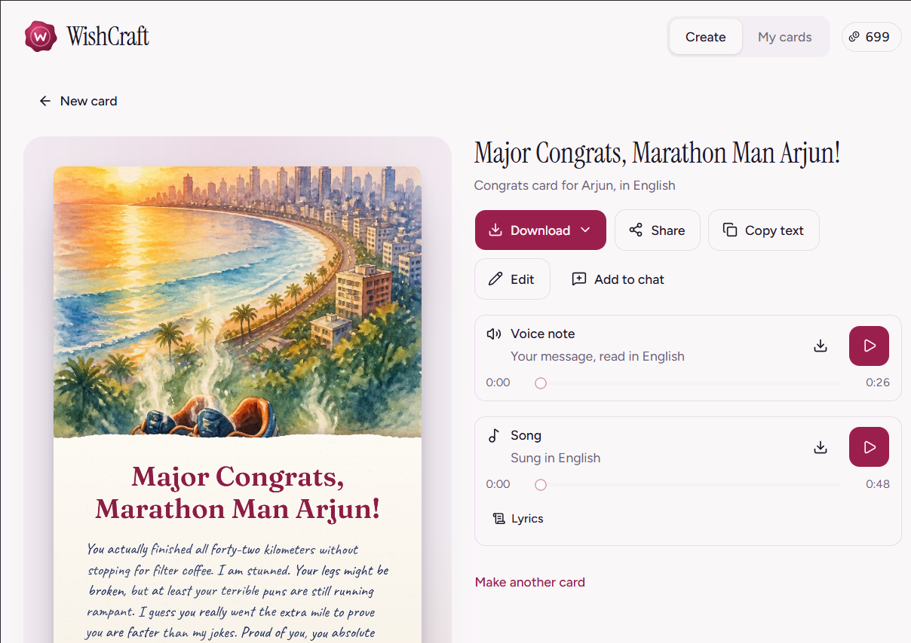

# WishCraft

Make a personal card for anyone, in any language: heartfelt words, original art, a voice note and a little song.



WishCraft is an [Anna](https://anna.partners) app. Choose the occasion, say who the card is for and one or two things you love about them, and WishCraft:

1. **Writes the message** in the language and tone you choose (25 languages, including Hindi, Spanish, Arabic, Chinese, Tamil and Swahili).
2. **Paints original card art** in the style you choose: watercolour, paper-cut, storybook, folk art, vintage postcard or dreamy photo.
3. **Records a voice note** that reads your message aloud, with a voice that speaks the card's language.
4. **Composes a song** with their name in the lyrics, long enough to sing every line.

The card is lettered by hand (or printed) in a typeface made for its script, so Hindi, Chinese, Arabic or Tamil cards look as natural as English ones. Edit the words, change the lettering or repaint the art, then download or share. Every card is saved to **My cards** in your own Anna storage.

You can also ask for a card from Anna chat, for example _"#WishCraft make a birthday card for my sister Priya, she loves gardening"_. Anna opens WishCraft with the details filled in.

## What's new in 0.2

0.2 is a full redesign and fixes every point from the first review. See [CHANGELOG.md](./CHANGELOG.md).

- **One audio player.** The voice note and the song share a single player, so they can never play over each other.
- **One download standard.** Card: JPG. Voice note and song: MP3 (WAV songs are converted in the app). Everything: ZIP. Names follow `WishCraft-<Name>-<Occasion>-<part>`.
- **Natural lettering.** Per-script handwriting and print faces, word-by-word ink variation, and line breaking that never starts a line with a comma or full stop.
- **Close it any time.** Each step is saved as it finishes. Art and songs keep rendering on Anna while WishCraft is closed, and reopening picks up the same jobs without paying twice.
- **Full songs.** Lyrics are written for the music model that will sing them, and the song length is sized to the lyrics.

## Cost

Everything runs on Anna's built-in services and is paid for with the user's Anna credits. WishCraft shows the cost before anything is created. As of October 2026:

| Step | Service | Typical cost |
|---|---|---|
| Message | `llm.complete` | under 1 credit |
| Card art | `image.generateAsync`, GPT Image 2, 1024×1536, low quality | 4 credits |
| Voice note | `audio.speak`, cheapest voice that speaks the card's language | 1–6 credits |
| Song | `music.generate`, cheapest model that sings the language: ACE-Step (about 35–60 s) or Lyria 3 (30 s) | 10–34 credits |

When no voice speaks a language (for example Bengali or Swahili), the voice note is turned off and the app says so. When no model sings a language, the song is sung in English and the app says so before you create.

## How it is built

- **Bundle-only Anna App** (manifest `schema: 3`, no Executa). Everything goes through the Anna Host API: no API keys, servers or extra installs.
- **React 19, TypeScript, Vite, Tailwind CSS 4 and [shadcn/ui](https://ui.shadcn.com) on [Base UI](https://base-ui.com)** (`base-nova` style). The build goes into `bundle/`.
- **Card renderer** on `<canvas>`: the art, a deckled paper sheet with grain, a printed headline and handwritten body set word by word. Fonts are bundled ([Fontsource](https://fontsource.org)), loaded per script with `document.fonts.load`.
- **Studio engine** (`lib/studio.ts`) lives outside React. It runs words, then art, voice and song in parallel, then the card. It saves the record after every step and resumes saved job ids with `getJob`.
- Cards are stored with `anna.storage.*` (records) and `anna.files.*` (images and audio). Downloads go through `files.download`.
- Works on desktop and in the Anna mobile app, with safe areas, 44 px touch targets, keyboard focus, reduced motion, and light and dark themes that follow Anna.

```
web/src/
  App.tsx                 layout, session restore, prefill from Anna chat (entry_payload)
  components/             composer, live preview, card studio, edit sheet, audio track, My cards
  components/ui/          shadcn/ui (Base UI) components
  lib/studio.ts           create / resume / retry / stop engine
  lib/records.ts          card records, session and preferences in Anna storage
  lib/card.ts, fonts.ts   canvas renderer, line breaking, per-script fonts
  lib/pricing.ts          picks models from llm.catalog and estimates credits
  lib/services.ts         llm / image / audio / music / files calls
  lib/audio.ts            the single shared audio player
  lib/mp3.ts, exporter.ts MP3 encoding, export names, ZIP
  lib/prompts.ts          LLM prompt and JSON parsing
tests/                    vitest unit and integration tests
```

## Develop

Requirements: Node 22+, [uv](https://docs.astral.sh/uv/), `npm i -g @anna-ai/cli`, then `anna-app login --host https://anna.partners`.

```bash
npm install
npm run build      # typecheck + build bundle/
npm run dev        # anna-app dev harness with real Anna storage (http://localhost:5180)
npm test           # unit and integration tests
npm run validate   # anna-app validate --strict
```

## Privacy

See [PRIVACY.md](./PRIVACY.md).

## License

[MIT](./LICENSE)
